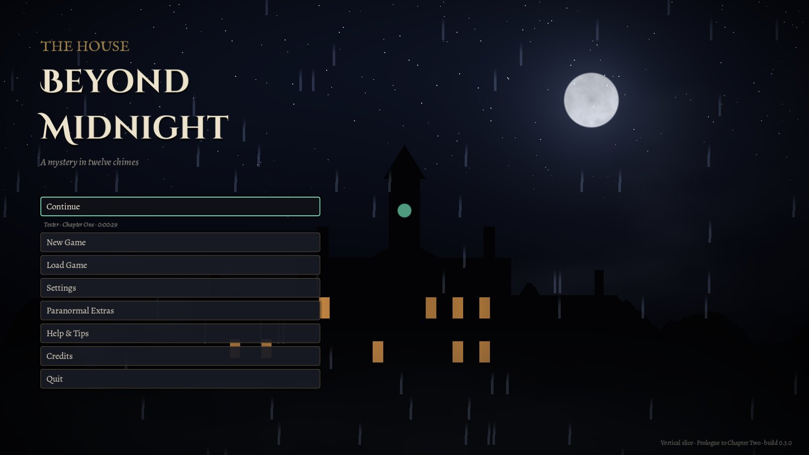
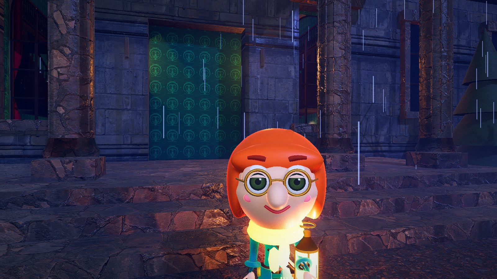
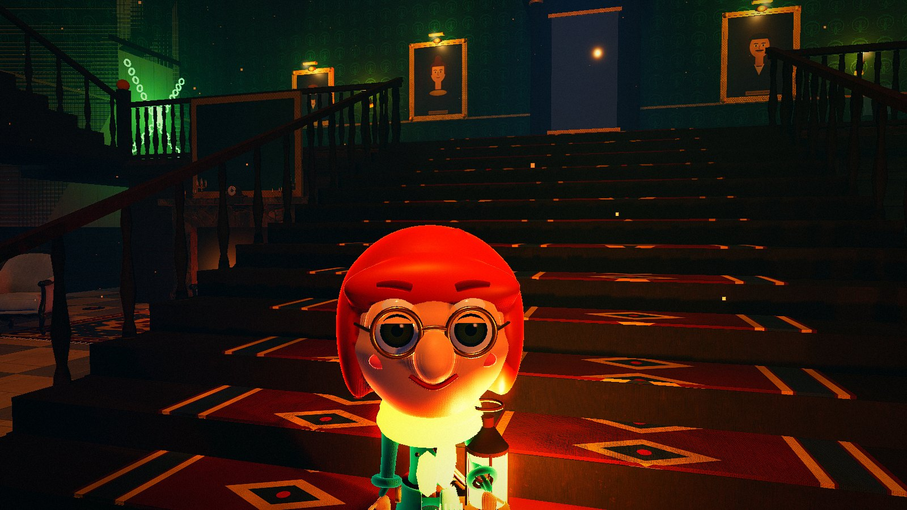
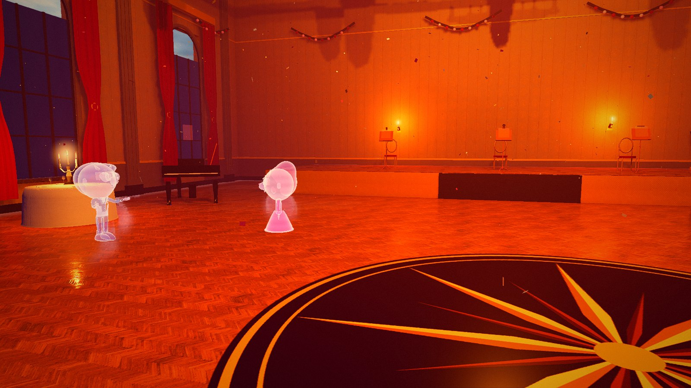
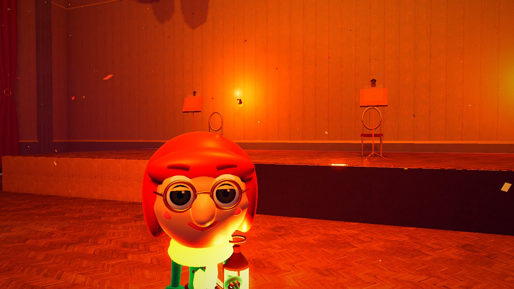
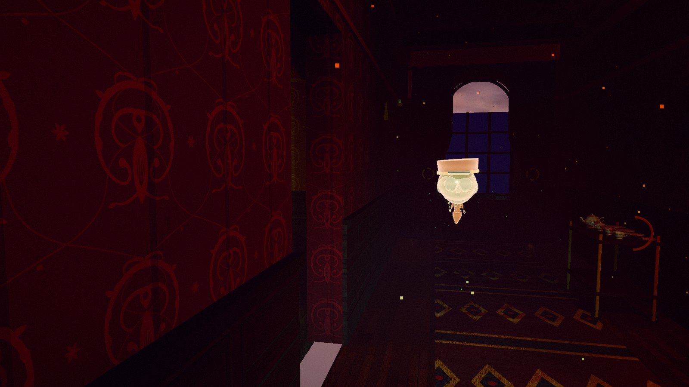
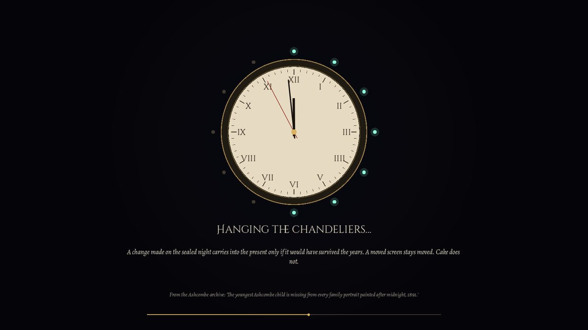
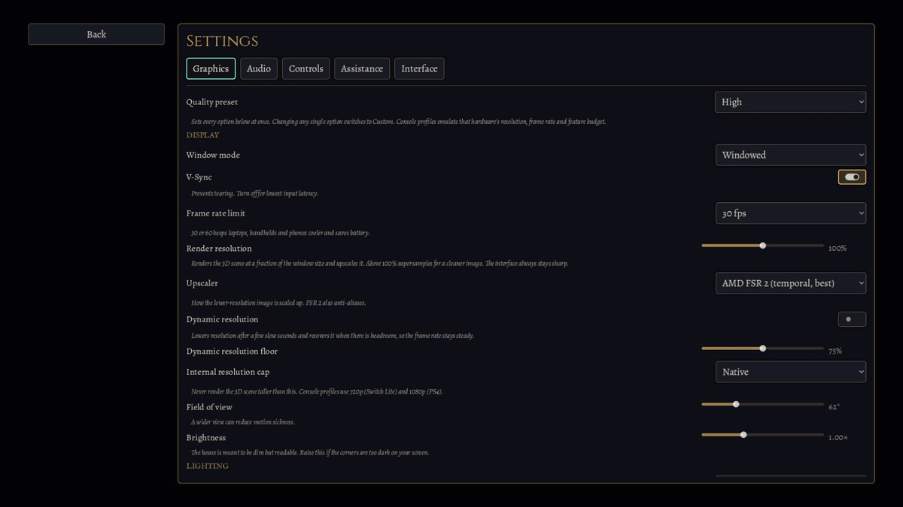

<p align="center">
  
</p>

<h1 align="center">The House Beyond Midnight</h1>

<p align="center"><i>A cosy-spooky mystery in twelve chimes.</i></p>

<p align="center">
  
  
  
</p>

It's New Year's Eve, one minute to midnight. Building surveyor **Avery Wren** has been sent to value
Ashcombe House before it's demolished, and arrives exactly on time. Every clock in the house says
11:59. They have said 11:59 since 1891.

Explore the house with the **Gloam Lantern**, which shows writing and doorways that exist only in its
light. Use the **Midnight Watch** to see what the house remembers, and to step back into the night
it all stopped. Settle the ghosts who can't let go of that minute, and strike the Grand Clock's
chimes one at a time.

This repository holds the **vertical slice**: the Prologue, Chapter One (*The Stopped Clocks*) and
Chapter Two (*The Last Waltz*), ending at the second chime.

## Download

Get the latest build from **[Releases](https://github.com/sadirhossain0/the-house-beyond-midnight/releases/latest)**.
Each platform is a single file:

| Platform | File | How to run |
| --- | --- | --- |
| Windows 10/11 | `HouseBeyondMidnight-…-Windows.zip` | Unzip, then double-click `HouseBeyondMidnight.exe`. Windows SmartScreen may warn because the game isn't code-signed yet: choose **More info → Run anyway**. |
| macOS 11+ (Intel and Apple silicon) | `HouseBeyondMidnight-…-macOS.zip` | Unzip and move the app to Applications. The first time, right-click it and choose **Open** (it isn't notarised yet). |
| Linux (x86_64) | `HouseBeyondMidnight-…-Linux.zip` | Unzip, run `chmod +x HouseBeyondMidnight.x86_64`, then start it. |
| Android 8+ (64-bit) | `HouseBeyondMidnight-…-Android.apk` | Copy it to the phone and open it; allow installs from this source when asked. This is a test build. |

You'll need a graphics card with Vulkan support (most from 2016 onward), 8 GB of RAM and about
5 GB of free space. The first launch takes a little while as the house is built.

---

## Screenshots

<table>
  <tr>
    <td></td>
    <td></td>
  </tr>
  <tr>
    <td align="center"><sub>Arriving at 11:59 in the rain</sub></td>
    <td align="center"><sub>The entrance hall and the Grand Clock</sub></td>
  </tr>
  <tr>
    <td></td>
    <td></td>
  </tr>
  <tr>
    <td align="center"><sub>The ballroom on the sealed night</sub></td>
    <td align="center"><sub>The band's stage, where the waltz loses a beat</sub></td>
  </tr>
  <tr>
    <td></td>
    <td></td>
  </tr>
  <tr>
    <td align="center"><sub>Raising the Gloam Lantern</sub></td>
    <td align="center"><sub>The guest wing, where Pip hides from the light</sub></td>
  </tr>
</table>

<sub>Captured in-engine on a software renderer; a real GPU renders cleaner shadows and fog.</sub>

## The cast

<p align="center"></p>

- **Avery Wren**, surveyor. Wears the wristwatch over the coat sleeve so it can be read without
  fuss, keeps a pencil behind one ear, and has never been late.
- **Mara Bell**, singer. Stopped mid-costume-change, which is why only one sleeve is sequinned.
  Counts in threes when nervous: three bangles, three curls.
- **The Night Porter.** Stooped from sixty years at the counter. Still carries an empty coat hanger
  and the ticket for hook seven.
- **Pip**, the youngest of the staff. Snuffs candles when frightened, and sews every lost button he
  finds onto his jacket.
- **The Forgotten Host.** His dance card has no names on it. He can't leave before the last dance,
  and the band never finished the waltz.

## What's in the slice

- **The house.**
  - The drive in a storm, the entrance hall with its imperial staircase, the guest wing and a
    hidden cloakroom, a guest room, the Grand Ballroom in two eras, and its balcony.
  - Built from CC0 Poly Haven materials and furniture, with volumetric fog, per-room colour
    grading and lightning.
- **Now and Then.**
  - Shift a room to the sealed night at an anchor clock.
  - Anything moved then stays moved now; a slice of cake doesn't.
- **Puzzles and deduction.**
  - Clues collect in the Field Journal; link two to make a deduction.
  - A three-tier hint system goes from a nudge to the answer.
- **The Forgotten Host.** A three-part encounter:
  - Flare the mirror he's hiding in.
  - Push the chairs onto the stars past the waltzing dancers.
  - Dance the last waltz on the beat.
- **Music.** "The Ashcombe Waltz", arranged for every room with adaptive layers. In Chapter Two the
  puzzle *is* the music: in the fourth bar, the third beat never comes.
- **Voices.** Synthesised for each character, speaking an invented language. No text-to-speech.
- **Extras.**
  - Wardrobe outfits.
  - Cheat codes written in lantern light.
  - Filters, achievements and collectibles.
- **Saves.**
  - Three slots with backups.
  - Export and import as files.
  - A full restore code, and a short *Midnight Code* you can write down.

<p align="center">
  
  
</p>

## Settings and accessibility

- **Graphics.**
  - Presets: Low, Medium, High, Ultra and Auto.
  - Hardware profiles for Switch Lite, PS4 and Steam Deck.
  - Dynamic resolution, FSR upscaling and a frame cap.
  - A performance overlay with each profile's budgets.
- **Subtitles.** Size, background and speaker-name options.
- **Assistance** (never affects achievements).
  - Extra composure candles, no composure loss, gentler ghosts and extended timing.
  - Aim assist and high contrast.
  - Reduced flashing and reduced motion.
- **Controls.**
  - Full key rebinding.
  - Xbox, PlayStation and Nintendo button prompts, with the Nintendo A/B swap.
  - Touch controls on phones and tablets.

## Controls

| Action | Keyboard and mouse | Gamepad |
| --- | --- | --- |
| Move / look | WASD / mouse | Left stick / right stick |
| Interact | E | A (Nintendo: B) |
| Raise the lantern / use the watch | Left mouse (hold) | RT |
| Lantern flare | F | X |
| Observe | Right mouse (hold) | LT |
| Dodge | Space | B |
| Lantern / Watch | 1 / 2 | D-pad left / right |
| Field Journal · Map · Hint | J · M · H | Y · View · D-pad up |
| Pause | Esc | Menu |

## Building

Requires **Godot 4.7.2** and its export templates. Large assets are stored with **Git LFS**:

```bash
git lfs install
git clone https://github.com/sadirhossain0/the-house-beyond-midnight
cd the-house-beyond-midnight
godot --headless --path . --import
tools/export_all.sh          # Windows, Linux, macOS and Android into build/
```

The Android export needs the Android SDK and a keystore set in Godot's editor settings. The macOS
build is signed ad hoc; distributing it needs an Apple Developer ID and notarisation.

### Regenerating assets

Every generated asset has a script that rebuilds it:

| What | Command | Needs |
| --- | --- | --- |
| CC0 textures, models, skies | `python3 tools/textures/prepare_cc0.py` | internet |
| Wallpapers, rugs, clock faces, symbols | `python3 tools/textures/generate.py` | Pillow |
| Characters (23 rigged models) | `python3 tools/blender/characters.py` | Blender `bpy` |
| Avery's car | `python3 tools/blender/car.py` | Blender `bpy` |
| Music | `python3 tools/audio/compose.py` | FluidSynth, FluidR3 GM |
| Sound effects and ambience | `python3 tools/audio/sfx.py` | numpy, scipy |
| Voices | `python3 tools/audio/voices.py` | numpy, scipy |

### Automated playthrough

```bash
godot --path . res://src/dev/playtest.tscn -- --out=/tmp/pt --preset=low
```

This drives the real game from arrival to the second chime: it walks every objective, plays the
Forgotten Host encounter, and saves a screenshot at each beat. It reports any objective that fails
to advance.

## Project layout

```
src/autoload   settings, controls, saves, audio, game state
src/world      the estate: rooms, props, materials, lighting, grading
src/chars      cast data and the procedural character animator
src/player     player, camera, Gloam Lantern
src/game       story (Prologue, Chapters 1–2), Host encounter, dialogue, game screen
src/ui         HUD, menus, title, loading, touch controls
tools          Blender, texture and audio generators
docs           roadmap, console porting notes, credits, media
```

## Roadmap

The next updates are planned in [docs/ROADMAP.md](docs/ROADMAP.md):

- **Update 2:** models, environments, animation and sound.
- **Update 3:** Chapter Three, *The Endless Library*.
- **Update 4:** loading speed, Android and automated testing.
- **Update 5:** the release path (itch.io, Steam, Google Play).

Notes for Switch and PlayStation are in [docs/CONSOLE_PORTING.md](docs/CONSOLE_PORTING.md).

## Credits

- Textures, furniture models and skies: [Poly Haven](https://polyhaven.com) (CC0).
- Music rendered with the FluidR3 GM soundfont (MIT).
- Fonts: Cinzel, Alegreya and IM Fell (SIL Open Font License).
- Full list: [docs/CREDITS.md](docs/CREDITS.md).
